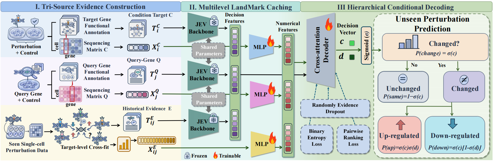
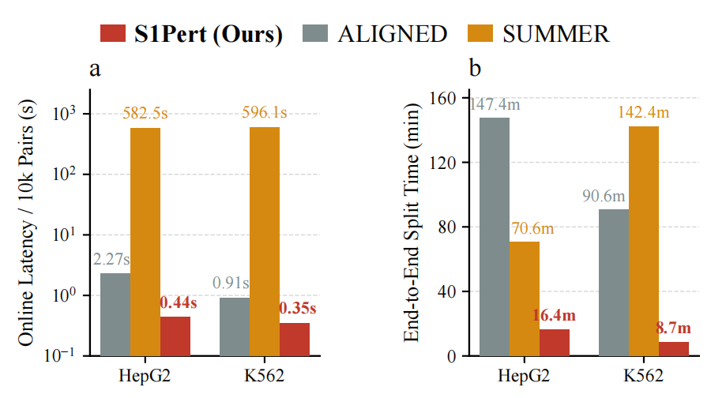
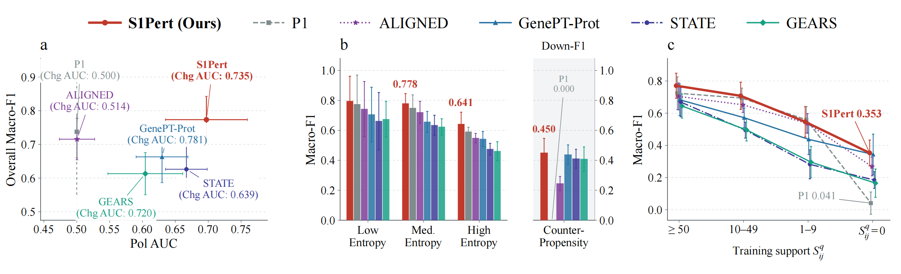
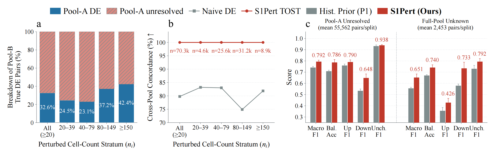

# S1Pert: Scalable Target-Specific Gene Response Prediction with System-One Intelligence



S1Pert predicts **Up / Unchanged / Down** for a query gene under a genetic
intervention in one cell line. Its frozen DECIDER-4B backbone encodes the
intervention, the query and TRAIN-derived response evidence. A freshly trained
conditional decoder produces the three-class probabilities. The release contains
the upstream experiments and downstream renderers for Tables II–IV and Figures 3–5.

## Documentation

[中文执行说明](README_zh.md) · [Paper-to-code map](docs/PAPER_TO_CODE.md) ·
[Data contract](docs/DATA_PIPELINE.md) · [Baseline adapters](docs/BASELINES.md) ·
[Cell-pool experiment](docs/CELL_POOL.md) · [Prior stress and runtime](docs/PAPER_STRESS_RUNTIME.md)

# How to run this code


Use a Linux checkout, Python 3.11 or newer, and a CUDA-compatible PyTorch build.
Run the following commands from the repository root:

```bash
python -m venv .venv
source .venv/bin/activate
# Historical core stack for CUDA 12.8. Use the matching CPU build for CPU-only tests.
python -m pip install torch==2.7.1 --index-url https://download.pytorch.org/whl/cu128
python -m pip install -e '.[test,train,paper]'
python -m pytest -q

export S1PERT_ROOT="$PWD/workspace"
python -m experiments.paper init --gpu 0
```

`init` creates configuration files only. `--work-dir` overrides `S1PERT_ROOT`.
To use existing raw matrices, pass `--data-root /path/to/raw_data` to `init`.
The command reads from this directory and writes generated artifacts to the
workspace. Resource paths inside JSON resolve relative to the JSON file.
Installing the core wheel exposes `s1pert`. Paper-section modules run from this
source checkout.

Install DECIDER's tested dependencies from `requirements-backbone-tested.txt`
before encoding. Baselines have separate dependency stacks: use their requirement
files and pinned upstream installation instructions. In particular, vLLM and
STATE need not share the core environment. `configs/interpreters.example.json`
shows how to select an interpreter per method without resolving away a virtual
environment's Python symlink.

```text
workspace/
  configs/             editable dataset, resource, training, baseline settings
  raw/                 original public h5ad matrices
  preprocessed/        streaming normalized moments and identity mapping
  strict_labels/       resolved labels plus inconclusive/reason masks
  data/CELL/seed_S/     fixed TRAIN/VAL/TEST records and cross-fitted evidence
  assets/              public annotations, graph inputs, generic model weights
  external/            pinned external baseline source
  cache/CELL/          frozen single-stream and joint landmarks
  runs/main/CELL/seed_S/ selected S1Pert checkpoint and aligned TEST predictions
  baselines/           independently prepared/fitted comparison methods
  paper/               generated tables, figures, diagnostics and execution logs
```

Section launchers **print their plan by default**. Add `--execute` to run the plan.
Each launcher runs a finite sequence and records errors. A failed stage stops its
downstream stages. The launcher does not start a monitoring daemon. Initialization,
registration and asset builders write their named outputs directly. Use a new
output directory for another protocol. Before reuse, the pipeline checks the
identities of completed source, configuration and data.

## **Dataset**

The benchmark consists of four independently modeled cell lines: HepG2, Jurkat,
RPE1, and K562 essential. Original public files, download URLs, sizes, and available
publisher checksums are in `configs/downloads.json`.

```bash
# Inspect first. The execution command downloads data, annotations and generic
# DECIDER weights into the workspace. Large assets are not in the source ZIP.
python -m experiments.paper download
python -m experiments.paper download --execute
python -m experiments.paper data --execute
python -m experiments.paper prepare --execute
python -m experiments.run_section table3 --execute
```

The four matrices total about 17.8 GB. DECIDER's public backbone is
[`Mapika/decider-4b`](https://huggingface.co/Mapika/decider-4b), revision
`c23ab4d2483e7c6a93484463e9afe1688b29bedd`. The manifest verifies the weight
SHA256. The downloader fetches the model source and tokenizer from the same
revision. The preparation step imports public function descriptions from reviewed
human UniProt into a new SQLite database. It fingerprints live annotation endpoints
and reports the actual snapshot.

## Preprocess

Processing streams h5ad counts, checks the count layer, canonicalizes gene IDs,
and normalizes each cell to linear counts per 10,000 UMIs. No global 2,000-HVG
restriction is imposed. Algorithm 1 uses scaled Welch direction tests and TOST
with equivalence factor 1.2, alpha 0.05, and joint BH across the three test families.
Final support requires at least 20 cells and 10 detected cells in both groups,
valid positive moments, and a non-self target–query pair. Labels are `0=Up`,
`1=Unchanged`, and `2=Down`. Unresolved pairs retain their masks and reasons.
Failure to reject a direction test alone is not an Unchanged label.

**Historical implementation detail:** joint BH covers the complete 3×gene family
before the final support and self-pair filters. Invalid tests contribute p=1.
Filtering the multiple-testing family first changes the statistical protocol.
Table III is derived from the newly adjudicated labels, not stored paper counts.

The main preparation generates target-disjoint 7:1:2 TRAIN/VAL/TEST partitions
for seeds **17, 29, 43, 61, 89**, separately in each cell. These are five repeated
holdouts, not five disjoint outer CV folds. Within TRAIN, five-fold cross-fitting
creates the 12-dimensional historical evidence and 108+1 evidence cards.
VAL/TEST evidence uses TRAIN responses only. Four-dimensional control covariates
and public gene functions supply the other inputs. See the data contract for
fallback provenance, variance, identifier mapping and seal schemas.

## Training & validation

### Frozen encoding and S1Pert training

```bash
# Includes preparation, encoding, full epochs, validation selection, independent
# restoration and evaluation for all configured cells/seeds.
python -m experiments.paper main
python -m experiments.paper main --execute

# Individual preparation/cache stages, useful before fitting baselines:
python -m experiments.paper prepare --execute
python -m experiments.paper encode --execute
```

Before the first run, edit `workspace/configs/a4.json` to select the GPU and set
resource budgets. The default disk guard requires 600 GiB of free space for
potentially large joint caches. This value is an operational budget, not a model
parameter. Set a suitable budget for the selected workload. Do not bypass failed
checks. Shared cache preloading and row gathering follow the memory budget.

#### Model and optimization contract

| Component | Released implementation |
|---|---|
| Backbone | Frozen 32-layer DECIDER-4B with hidden width 2,560 and no A4 LoRA |
| Single-stream cache | Layers 0:24, compression, layers 24:32 and final norm |
| Landmarks | 16 intervention + 16 query + 4 evidence tokens |
| Joint cache | Upper-eight-layer forward pass over the 36-token stack, pooled into four summaries, with evidence-present and evidence-absent versions |
| Decoder | Width 512, two pre-LN cross-attention blocks, eight heads, FFN 2,048 |
| Joint interaction | Zero-initialized residual cross-attention inside the new network |
| Outputs | Change probability and conditional Up probability, factorized into Up/Same/Down |
| Main optimization | AdamW, LR 1e-4, weight decay 0.01, clipping 1.0 |
| Training | Effective batch 4,096, 10–100 epochs, validation patience 10, min delta 1e-4 |
| Ranking | Weight 0.02, margin 0.05, 512 pairs/update |
| Evidence dropout | 0.10, synchronized numerical/text/joint evidence removal |

Compression preserves a tail and segment means. The 16-landmark setting uses 12
segment means and four tail states. The four-landmark setting uses three segment
means and one tail state. Class prediction is the argmax of
`[P(change)*P(up|change), 1-P(change), P(change)*(1-P(up|change))]`.
The released A4 does not use validation-tuned hierarchical readout thresholds.
Task weights start from a fresh initialization. TRAIN evidence serves as an input.
The model does not add it to the output as a fixed prior prediction. Independent
baselines never become S1Pert's output anchor. The pipeline seals the checkpoint,
configuration, source and cache identities. It restores the model in an independent
process before accepting TEST evaluation.

The top-level main pipeline requires a new run directory. It does not provide an
automatic training-resume service. Individual preparation and encoding stages
verify completed outputs. Inspect incomplete stage directories before rerunning
them. An explicit repeat evaluation can replace the current run's prediction and
report files.

### Eight baselines and Table II

All methods use the same fixed TEST pair axis. The release includes the actual
training and inference adapters. It also documents each adaptation and budget:

| Method | Computation in this benchmark |
|---|---|
| GenePT-Gene / GenePT-Prot | Frozen generic gene or joint gene–protein representations, plus a fresh multinomial logistic classifier selected on VAL |
| Qwen3-4B-LoRA | Discriminative local Qwen classifier with LoRA rank 32 and the historical bounded sampling budget of 512 TRAIN rows per epoch across 2:2:4 stages |
| GEARS | Official graph model and loss with TRAIN/control expression, public GO and VAL-selected effect thresholds |
| scGPT | Official expression generator with a generic pretrained encoder and VAL-selected effect thresholds |
| STATE | Fresh official StateTransition task model with energy loss and generic ESM2 intervention representations |
| ALIGNED | Recovered six-stage MLP adaptation, two complete abductive alignment/refinement rounds, final native neural/knowledge rule |
| SUMMER | Local Qwen3-8B, official retrieval priorities, public-summary generation and batched vLLM rationale/decision inference |

STATE is the ST-native strict-query adaptation, not a pretrained SE+ST pipeline.
Qwen is the actual small-budget local classifier, not an official PertReasonLM
SFT/GRPO reproduction. SUMMER is training-free and uses Qwen3-8B in place of
Llama3. These names and distinctions are retained in output provenance.

#### Acquire baseline assets

```bash
python baselines/fetch_external.py --list
python baselines/fetch_external.py --root "$S1PERT_ROOT" \
  --repo gears --repo scgpt --repo state --repo perturbqa
python baselines/fetch_external.py --root "$S1PERT_ROOT" \
  --asset genept --asset kg --asset gene2go --asset esm2
python baselines/prepare_public_edges.py \
  --archive "$S1PERT_ROOT/assets/baselines/kg.zip" \
  --out "$S1PERT_ROOT/assets/public_edges.sqlite"
python baselines/prepare_esm2.py \
  --source "$S1PERT_ROOT/assets/esm2_public" --out "$S1PERT_ROOT/assets/esm2" \
  --metadata "$S1PERT_ROOT/data/hepg2/dataset.json" \
  --metadata "$S1PERT_ROOT/data/jurkat/dataset.json" \
  --metadata "$S1PERT_ROOT/data/rpe1/dataset.json" \
  --metadata "$S1PERT_ROOT/data/k562_essential/dataset.json"
```

Use [the asset guide](baselines/ASSETS.md) to acquire the generic Qwen3-4B,
Qwen3-8B and scGPT whole-human assets. Record the revisions and checksums. Store
the assets in `assets/Qwen3-4B`, `assets/qwen3_8b`, and `assets/scgpt`. Build the
Qwen graph with `baselines/language/build_graph.py`. The script's `--help` output
lists the four-source fetch manifest and pinned snapshots. ALIGNED uses a separate
signed regulatory graph:
```bash
python scripts/download_assets.py \
  --manifest data_prep/public_knowledge/sources.json --root "$S1PERT_ROOT" \
  --group public_knowledge
python -m data_prep.build_public_knowledge --work-dir "$S1PERT_ROOT"
```

This command builds `assets/public_knowledge.sqlite` and `assets/public_go.sqlite`
from public sources without empirical response tables. It verifies the historical
signed-edge and accession-mapping row digests. The resulting database is the view
used by ALIGNED. It is not a byte-identical copy of an unrelated full knowledge
database. Default historical hashes reject changed live downloads. Refreshed-source
mode requires an explicit option and writes a separate provenance record. See
[baselines/aligned](baselines/aligned/README.md) for the full ALIGNED instructions,
license and source-fidelity details.

#### Run methods and generate the comparison

```bash
# One method, all 20 splits:
python -m experiments.paper baselines --methods ALIGNED --execute

# Alternative to the S1Pert training workflow above: run all nine methods in a NEW main-run directory:
bash experiments/run_main_table2.sh --python-map configs/interpreters.example.json
bash experiments/run_main_table2.sh --python-map configs/interpreters.example.json --execute

# If the S1Pert training workflow above is complete, run ONLY the eight comparisons:
bash experiments/run_main_table2.sh --python-map configs/interpreters.example.json \
  --methods GenePT-Gene GenePT-Prot Qwen3-4B-LoRA GEARS scGPT STATE ALIGNED SUMMER \
  --registry-out "$S1PERT_ROOT/paper/baseline_predictions.csv" \
  --table-out "$S1PERT_ROOT/paper/baseline_table2" --execute
# Then register ALL nine completed methods and generate the final Table II:
bash experiments/run_main_table2.sh --evaluate-only --execute
```

Before execution, populate the interpreter map with the prepared environments.
Choose either the all-nine route or the existing-S1Pert route. The main pipeline
refuses an existing main-run directory. For another aggregation, choose new
`--registry-out` and `--table-out` paths. Do not overwrite registered results.
The common orchestrator writes commands and stage wall times under
`paper/execution_logs`. Asset preparation requires an explicit step. The training
launcher does not fetch a replacement model in the background. See
[BASELINES.md](docs/BASELINES.md) for family-specific commands and installation
details.

Registration produces `paper/predictions.csv` and performs exact target/query/label
alignment checks. Table II is recomputed from the raw prediction files. The output
under `paper/table2` includes per-split results, a summary, formatted CSV and LaTeX.
Metrics include Macro-F1, balanced accuracy and class-wise P/R/F1. Statistics use
the five-split mean and sample SD (`ddof=1`). Complete output requires all nine
methods × four cells × five seeds. `--allow-partial` produces explicitly partial
output. It does not fill missing runs. Hard-only SUMMER exports support
classification metrics, not an invented ranking AUC. Native invalid answers remain
prediction errors.

## Reproducibility

### Measured runtime: Fig. 5

```bash
# Plan only by default. This execution performs NEW cold-cache work and training.
bash experiments/run_runtime_fig3.sh --python-map configs/interpreters.example.json --execute

# Separate loaded-model online-only benchmark, no claim of complete end-to-end time:
bash experiments/run_runtime_fig3.sh --runtime-mode online \
  --python-map configs/interpreters.example.json --execute
```

Fresh mode measures HepG2 and K562 with seed 17 for S1Pert, ALIGNED and SUMMER.
It runs offline preparation, actual training for applicable methods and complete
TEST inference in new timing directories. The calculation explicitly amortizes
offline S1Pert encoding and SUMMER public summaries across five splits. Online
latency excludes model loading. End-to-end cost includes setup and all measured
phases.
Inference latency per 10,000 pairs is scaled from a complete timed test pass.
The graph does not use saved prediction replay, stored hours, or hardcoded speedup.
Use the interpreter map for S1Pert, ALIGNED and SUMMER. Their pinned dependencies
belong in separate environments. Factory measurements occur inside the selected
worker's synchronized timing region. Worker startup and IPC are recorded separately
and included in end-to-end cost. Keep the physical GPU selection consistent. See
the timing guide for exact measurement scopes. Complete rationale generation with
SUMMER can be expensive.



### Validation, packaging and reuse

```bash
python -m pytest -q
python scripts/audit_paper_coverage.py
python scripts/check_release.py
python scripts/package_release.py --out ../S1Pert_source.zip
```

Tests use synthetic data for model gradients, statistical labels, cross-fitting,
alignment, fresh tiny training, separate-process restoration, ALIGNED's two-round
flow, metric aggregation and plotting. `VALIDATION_REPORT.json` records what was
executed for this release. Packaging validation does not rerun the full biological
study. Historical score identity also depends on the recorded raw data, annotation,
external-source snapshots and weight snapshots. The baseline and provenance
documents list asset-specific differences.

The ZIP contains UTF-8 source, configurations, documentation, upstream attribution
and a per-file hash manifest. It excludes raw matrices, model/task checkpoints,
feature caches, private paths, contacts, credentials and Git history. Selected A4
head checkpoints support independent inference restoration. They are not provided
as optimizer-state continuation checkpoints. Existing run seals intentionally
detect changes to configuration, data and source. They do not silently recertify a moved or edited
historical run.

# Interpretable Analysis

## Ablation and target permutation: Table IV

```bash
bash experiments/run_ablation_table4.sh --execute
```

The launcher retrains NO_JEV, NO_JOINT, FLAT, NO_RANK, and NO_MASK on K562 for all
five splits. It uses the selected full S1Pert checkpoints as the independent
reference. NO_JEV retains numerical evidence, covariates and the decoder. NO_JOINT
removes the joint branch. FLAT replaces the factorized head with three-way softmax
and retains the historical ranking objective. NO_RANK sets rank weight to zero.
NO_MASK disables evidence dropout. Each variant is trained from scratch.
The fixed-model permutation diagnostic shuffles targets within a query while
keeping query and prior evidence unchanged, with no retraining or test tuning.
Outputs: `paper/table4` plus native variant runs and diagnostic predictions.

## Prior stress: Fig. 3

```bash
bash experiments/run_prior_stress_fig1.sh --execute
```

This recomputes the independent TRAIN-only P1 baseline, within-query Chg/Pol AUC,
entropy bins, counter-propensity Down-F1 and four training-support strata from
registered predictions. Displayed methods are S1Pert, P1, ALIGNED, GenePT-Prot,
STATE and GEARS. All registered comparators remain in the paired Wilcoxon/Holm
family. Figure values are read from `paper/prior_stress/summary.csv`.

The historical experiment used **fixed normalized entropy thirds**, not empirical
tertiles. The optional `--entropy-mode train-quantiles` is a separately identified
experiment. Undefined AUCs/empty strata remain missing, not zero. The complete
figure requires 20 valid splits for each displayed metric. See the detailed guide
for score conventions and the scope of repeated-split significance tests.



## Disjoint cell pools and boundary evaluation: Fig. 4

```bash
bash experiments/run_cell_pool_fig2.sh --execute
```

The workflow partitions K562 cells by target/control and batch into disjoint
Pool A (one third) and Pool B (two thirds). It runs the statistical and naive label
rules, derives reference-DE fates and cross-pool concordance, and then performs
frozen-model boundary inference. The 76,047 reference count in a historical
figure is **not hardcoded**. Every count comes from the supplied matrix, pool
assignment and statistical outputs. Prediction uses the original model's
full-control context. Pool-B perturbed responses enter evaluation truth only.
Full-pool unknown pairs form a nested subset of A-unknown/B-resolved pairs.
The stage does not train a new task model.



# License and publication notes

Review [LICENSE_STATUS.md](LICENSE_STATUS.md) before publication. Third-party
licenses and notices remain attached. The repository owner must choose the license
for original code. [ANONYMITY.md](ANONYMITY.md) covers repository hosting metadata.
A source ZIP cannot anonymize the identity of a public account.
