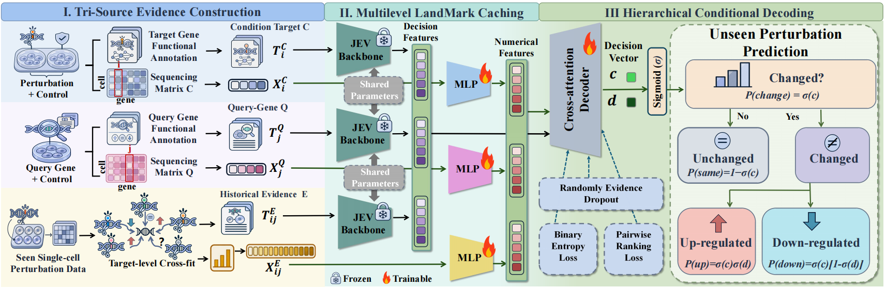
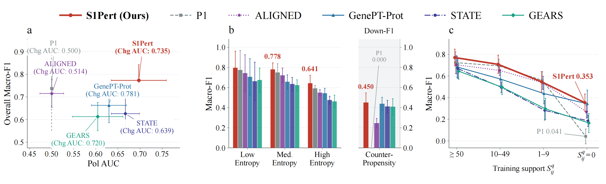
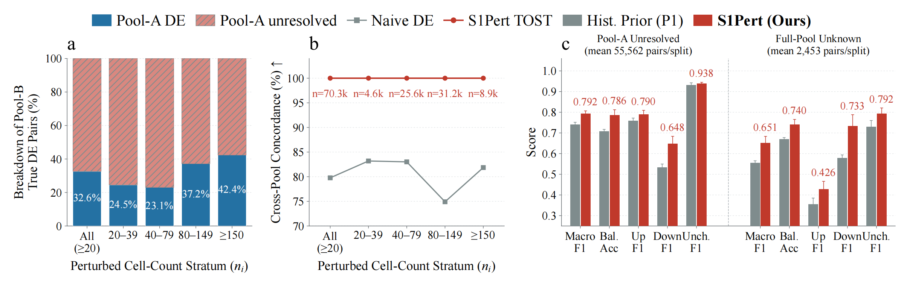
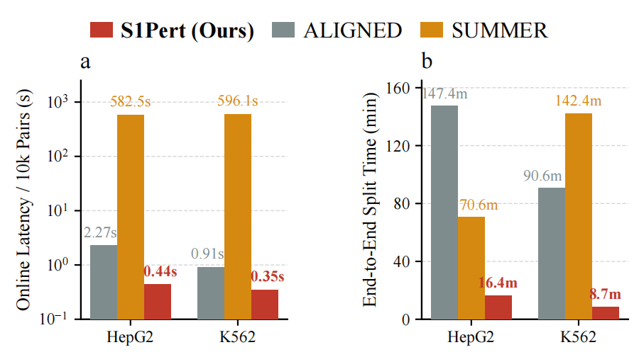

# S1Pert 可复现工程：中文执行说明



本指南介绍如何运行论文 Tables II–IV 与 Figures 1–3 对应的实验，包括逐样本结果生成、结果汇总和绘图。当前核心方法为 A4，该方法冻结 DECIDER-4B，用于提取三路输入及联合表示，并从头训练一个小型解码器，直接输出上调、不变和下调概率。

## 一、安装与统一路径

解压源码包后，在仓库根目录运行以下命令：

```bash
python -m venv .venv
source .venv/bin/activate
python -m pip install -e '.[test,train,paper]'
export S1PERT_ROOT="$PWD/workspace"
python -m experiments.paper init --gpu 0
```

所有正式数据、缓存和结果都会写入 `S1PERT_ROOT`。也可以在每条命令中通过 `--work-dir` 指定工作目录。如果已有原始数据，请在初始化时添加 `--data-root /path/to/raw_data`。JSON 中的路径相对于对应的 JSON 文件解析。

编码环境的依赖见 `requirements-backbone-tested.txt`。建议为 STATE、vLLM 和经典基线分别创建独立环境，并在 `configs/interpreters.example.json` 中指定各方法使用的 Python。请勿将不同虚拟环境的解释器替换为系统 Python。

## 二、数据下载、处理和主模型

```bash
python -m experiments.paper download --execute
python -m experiments.paper data --execute
python -m experiments.paper prepare --execute
python -m experiments.run_section table3 --execute
python -m experiments.paper main --execute
```

第一条命令会下载四个公开 h5ad 文件、公共注释和通用 DECIDER 权重。源码包不包含这些数据和权重。

数据处理使用线性 CP10k、Welch 方向检验、TOST 等效检验和联合 BH，并保留未裁决样本的原因。类别固定为 `0=Up, 1=Same, 2=Down`。不能仅凭“没有显著变化证据”将样本标记为不变。

四个细胞系分别建模。随机种子为 `17/29/43/61/89`，数据按靶点分组并以 7:1:2 划分。这五组实验是五次随机留出，不是五折互斥交叉验证。训练证据在 TRAIN 内进行五折交叉拟合。

主流程依次执行数据准备、三路/联合缓存、完整 epoch 训练、验证集选模、独立进程恢复和 TEST 评价。A4 的默认有效 batch 为 4096，训练 10–100 个 epochs，早停 patience 为 10。资源配置位于 `workspace/configs/a4.json`。默认缓存空间门槛较高，请根据机器配置明确设置。

## 三、八个对比方法

八个对比方法为 GenePT-Gene、GenePT-Prot、Qwen3-4B-LoRA、GEARS、scGPT、STATE、ALIGNED 和 SUMMER。资产下载与构建方法见 [ASSETS.md](baselines/ASSETS.md)，具体适配说明见 [BASELINES.md](docs/BASELINES.md)。下载外部资产时，请统一添加 `--root "$S1PERT_ROOT"`，避免文件写入其他默认目录。

ALIGNED 包含实际的两轮训练、独立恢复和最终概率导出源码。公共有符号图谱与 GO 由 `data_prep/build_public_knowledge.py` 根据公开原始文件构建。ALIGNED 原始核心代码的哈希已经核验。科学实现保持不变，仅调整环境路径和输入/输出接口。

Qwen 对比项沿用历史小预算配置。STATE 使用 ST 适配版本。SUMMER 使用本地 Qwen3-8B 推理版本。文档会明确记录这些差异，因此这些实现不等同于各原论文中未经修改的完整系统。

```bash
# 在全新工作区中运行全部九个方法。该流程替代前面的主模型单独运行流程：
bash experiments/run_main_table2.sh --python-map configs/interpreters.example.json
bash experiments/run_main_table2.sh --python-map configs/interpreters.example.json --execute
# 如果已经完成前面的主模型，只运行八个基线：
bash experiments/run_main_table2.sh --python-map configs/interpreters.example.json \
  --methods GenePT-Gene GenePT-Prot Qwen3-4B-LoRA GEARS scGPT STATE ALIGNED SUMMER \
  --registry-out "$S1PERT_ROOT/paper/baseline_predictions.csv" \
  --table-out "$S1PERT_ROOT/paper/baseline_table2" --execute
# 如果当前工作区已有完整预测，仅重新登记并汇总结果：
bash experiments/run_main_table2.sh --evaluate-only --execute
```

Table II 默认要求九个方法、四个细胞系和五个种子的结果全部齐全。每个划分的预测按 target/query/label 逐行对齐，并汇总均值和样本标准差。不得用硬标签构造连续概率来计算排序 AUC。

“全部九个方法”和“已有主模型＋八个基线”两条路线只能选择其一。主模型总流程不会在已有目录中自动续训。再次汇总时，请通过 `--registry-out` 和 `--table-out` 指定新位置，以保留原有结果。

## 四、论文补充实验

```bash
bash experiments/run_ablation_table4.sh --execute
bash experiments/run_prior_stress_fig1.sh --execute
bash experiments/run_cell_pool_fig2.sh --execute
bash experiments/run_runtime_fig3.sh --python-map configs/interpreters.example.json --execute
```

- Table IV：在 K562 的五个种子上，从头训练五类消融模型，并执行固定模型的靶点置换诊断。
- Fig. 1：根据逐样本预测重新计算跨靶点 AUC、先验熵、逆倾向和训练支持度。

  

- Fig. 2：重新划分 K562 的不相交 A/B 细胞池，执行统计裁决和冻结模型边界评价。

  

- Fig. 3：实际测量冷缓存、训练和推理耗时。该步骤会重新训练计时用模型，运行时间较长。

  

计时流程通过解释器映射分别运行 A4、ALIGNED 和 SUMMER，以避免不同依赖版本之间的冲突。在线时间取各子进程内部同步后的测量区间。进程启动开销单独记录，并计入端到端时间。

所有表格和图都读取本次执行生成的文件，不使用预置的成绩数组。历史先验熵采用归一化熵的等宽三档，而不是样本三分位。历史图中的参考样本数也会根据数据重新计算，不会硬编码。

移除 `--execute` 后，命令只显示执行计划。程序不会常驻监测。

## 五、交付前检查

```bash
python -m pytest -q
python scripts/audit_paper_coverage.py
python scripts/check_release.py
python scripts/package_release.py --out ../S1Pert_source.zip
```

验收范围见 `VALIDATION_REPORT.json`。CPU 合成测试用于验证工程逻辑和恢复流程，并不等同于重新运行全部正式实验。

源码包不包含原始数据、模型权重、大型缓存、用户路径、凭据和 Git 历史。第三方许可证与来源信息会保留。公开发布前，原作者需要确定自有代码的许可证。

完整命令、参数、资源要求和复现边界以英文 [README](README.md) 及对应专题文档为准。
