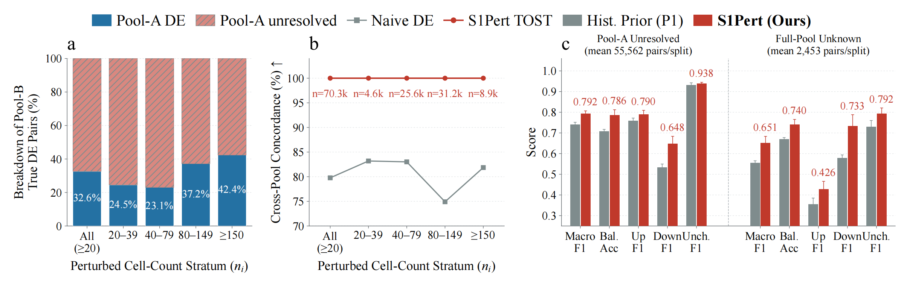

# Table III and Fig. 4: label support and the cell-pool boundary

These stages compute the paper's statistics from prepared inputs. Table III reads the strict label arrays. Fig. 4 starts from the original K562-essential count matrix, creates the fixed disjoint A/B cell pools, adjudicates both pools, and evaluates the trained S1Pert model and its standalone P1 comparator.

Install the package, then run all commands from the repository root. Every stage accepts `--work-dir`. The equivalent environment setting is `S1PERT_ROOT`.

## Inputs and outputs

The work directory contains:

```text
raw/scPerturb_prepro/ReplogleWeissman2022_K562_essential.h5ad
preprocessed/{cell}/                 # linear moments and original strict labels
strict_labels/{cell}/                # hard_label.npy, resolution_code.npy
data/{cell}/                        # immutable identities and five target splits
cache/k562_essential/                # frozen shared/card/joint representations
runs/main/k562_essential/seed_{s}/   # selected, restored, tested S1Pert checkpoint
cell_pool/pools/                    # generated cell assignment, moments, A/B labels
cell_pool/prepared/seed_{s}/         # label-free keys and separate B references
cell_pool/predictions/seed_{s}/      # frozen S1Pert/P1 probabilities and seals
paper/table3/                       # derived CSV, JSON audit, LaTeX
paper/fig2/                         # fidelity, boundary metrics, PDF, PNG, audits
```

The main checkpoint directory requires `effective_config.json`, `best.pt`, `convergence.json`, `restore_report.json`, `test_report.json`, and `test_predictions.npz`. `--main-run-root` selects another parent directory containing `k562_essential/seed_{s}`. `--model-dir` selects one exact model directory. The original config, cache, code, and checkpoint bindings must still validate. A moved or modified historical checkpoint is not automatically equivalent to a newly reproduced checkpoint.

## Stage 1 and Table III

Source preprocessing applies `X / original_UMI * 10,000` on the linear scale. Group moments accumulate in float64 and are stored in float32 before testing. Label assignment uses a 1.2-fold margin, alpha 0.05, scaled one-sided Welch tests, and the TOST intersection-union p-value. Both groups require at least 20 cells and 10 nonzero observations per queried gene, plus positive estimable means and nondegenerate test variance. The class codes are Up=0, Same=1, and Down=2. Unresolved pairs provide no supervision.

**Ordering in the original implementation:** Each target's BH family contains all 3G hypotheses, including the self gene and genes with insufficient nonzero support. Invalid mean or variance tests receive p=1. Cell and nonzero eligibility is applied after BH. Self pairs are removed during model-record construction and count reporting. Removing low-support or self genes before BH changes the historical label protocol. The portable code preserves the original ordering.

```bash
python -m plotting.make_table3_stats --work-dir /path/to/work
```

The script derives target and query counts for all four cells, nonself candidate and eligible pairs, Up/Same/Down counts, unresolved percentages, and DE/Same ratios. The unresolved percentage uses **all nonself candidates**, including low-support and nonestimable pairs. Eligible pairs have resolution code 0, 1, 2, or 7. Identity-matched self pairs are excluded from every denominator and class count. The audit records hashes for all input label arrays and identity metadata.

## Stage 6: fixed disjoint A/B adjudication

Prepare and encode all five K562 target splits before this stage. The pool stage does not read task predictions or learned weights.

```bash
python -m data_prep.cell_pool build --work-dir /path/to/work
python -m data_prep.cell_pool prepare --work-dir /path/to/work
python -m data_prep.cell_pool fidelity --work-dir /path/to/work
```

The cell split uses seed 20261016 and is stratified by target/control group and recorded batch. Pool A receives the nearest integer to n/3 cells from each group. Pool B receives the remaining cells. Largest-remainder allocation distributes Pool-A cells across batches, with seeded random tie-breaking and within-batch shuffling. Each group has a separate RNG, so assignments remain stable when the eligibility of another group changes. Target and control cells are mutually exclusive across Pools A and B. All model seeds use the same cell assignment: 17, 29, 43, 61, and 89.

The historical pool scope is the **union of the five fixed TEST target sets** plus control cells. Other target rows retain unresolved labels and zero pool counts. Full pooled moments are reconstructed for all source groups and checked against the Stage-1 moments. Validation covers the original UMI denominators, integer counts, gene identities, and frozen target-split hashes. This release retains the A/B moment arrays, so fidelity can run again without rereading raw X. The historical implementation discarded target moments and later rebuilt Pool A.

Both pools use the original 1.2/0.05/20/10/3G-BH label protocol. The comparison rule copies the margin labels and assigns Same to a quality-eligible pair when both `q_up > 0.05` and `q_down > 0.05`. This naive rule does not test equivalence.

Fidelity bins use Pool-A perturbed-cell counts: all evaluated targets with at least 20 cells, 20–39, 40–79, 80–149, and at least 150. False invariance is the fraction assigned Same among Pool-B DE pairs satisfying Pool-A quality eligibility and self exclusion. Concordance uses pairs resolved in both pools. The output records candidate and eligible coverage separately.

One historical denominator detail is retained. The `all` **candidate coverage** denominator also includes selected groups with 1–19 Pool-A cells. The reference-DE and concordance denominators include only evaluated groups with at least 20 Pool-A cells. This detail does not affect the displayed Fig. 4a/b metrics.

All counts are derived from the arrays. The optional `--expected-cells` argument for `build` and `--expected-reference-de` argument for `fidelity` or plotting assert a supplied audit expectation. They do not provide counts for the calculation.

## Frozen S1Pert and P1 boundary inference

For each original target split, preparation selects nonself TEST pairs with unresolved Pool-A labels and resolved Pool-B labels. `keys.npy` contains only target and query indices. `records.npy` stores the separate Pool-B evaluation labels. `original_unknown.npy` selects the nested subset also unresolved under the original full-pool labels. As a result, `FULL_UNKNOWN_B_RESOLVED` is nested within `A_UNRESOLVED_B_RESOLVED`. It does not contain every full-pool-unknown and Pool-B-resolved pair.

```bash
for seed in 17 29 43 61 89; do
  python -m experiments.cell_pool predict --work-dir /path/to/work --seed "$seed"
done
python -m experiments.cell_pool evaluate --work-dir /path/to/work
python -m plotting.plot_fig2_label_boundary --work-dir /path/to/work
```

The inference command loads the converged and independently restored S1Pert head, validates the original bindings, and freezes the model weights. It reconstructs the TRAIN-only query prior and checks its numeric features and card identities against every original TEST row. P1 uses these priors as an independent comparator. P1 predictions are never added to the S1Pert output.

For previously unseen structural pairs, the command loads only DECIDER's frozen upper eight layers and final norm. It combines the existing condition, query, and prior block-24 landmarks, then applies the same selected direct head. Inference uses the historical CPU BF16 tail implementation. The complete generic weight file passes checksum verification before the selected tensors are loaded.

Eight deterministic original TEST rows provide an execution-parity check. The historical predeclared tolerances for CPU/GPU BF16 execution are a maximum absolute probability error of 0.01 and a mean absolute error of 0.002. A failed check stops inference. Existing matching TEST keys reuse sealed probabilities from the same checkpoint. The frozen model computes the remaining keys. `--parity-only` produces a parity report without an evaluable prediction seal. Use a separate `--output` directory for this diagnostic.

Pool-B perturbed responses and labels serve only as evaluation references. The frozen model retains its original full-pool untreated-control context inputs. A/B-disjoint controls are used for label adjudication. This experiment is a selected technical proxy for cell-pool reproducibility. It does not estimate performance for every unresolved pair or provide independent biological replication.

## Plot and verification

Fig. 4a plots all derived Pool-A DE, Same, and unresolved outcomes for Pool-B DE pairs. Fig. 4b plots concordance across the five cell-count bins. Fig. 4c reports Macro-F1, balanced accuracy, and Up/Down/Same F1 for both nested subsets, with the sample standard deviation (`ddof=1`) across repeated target holdouts. The five target splits overlap, so the standard deviation measures split variation. Plotting reads the generated CSV files, checks summaries against per-seed results, and emits a source-hash audit. The paper output is `fig_label_boundary.pdf` plus a PNG file. The `fig2_label_boundary` aliases are retained. Times New Roman is preferred when installed, and DejaVu Serif is the default fallback. `--font` (alias `--font-family`) and `--font-fallback` select installed fonts. The audit records the requested and selected fonts. No font is bundled.



Dependencies include the package data stack (NumPy, SciPy, pandas, PyArrow, and h5py), Matplotlib for plotting, and the pinned core PyTorch/Transformers/safetensors environment for real frozen inference. This stage requires no additional training framework.

```bash
python -m pytest -q tests/test_paper_cell_pool.py
```

The tests use small artificial count matrices and probabilities. They cover exact and disjoint batch allocation, original-UMI linear moments, streamed pooled reconstruction, strict and naive labels, nested and self-excluded subsets, Table III denominators, label-free key validation, prediction seals, sample standard deviations, and plots with derived counts. They do not validate scientific scores or run formal training.
