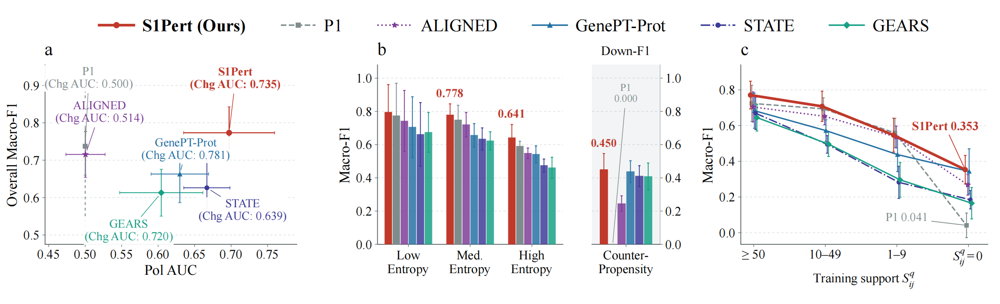
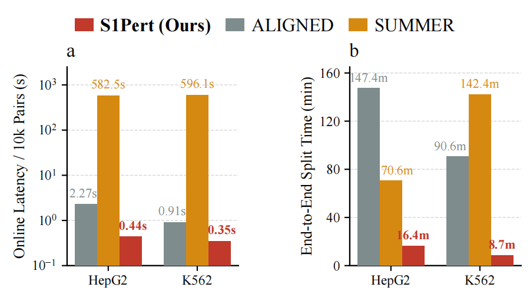

# Prior-stress evaluation and runtime benchmarks

These stages use the prepared workspace and predictions from the packaged training and inference programs. Every plotted value comes from raw per-pair predictions or an executed timing phase.

## Workspace and prediction contract

Set one workspace root, or pass `--work-dir` to each command:

```bash
export S1PERT_ROOT=/path/to/workspace
```

Stage 3 produces `data/CELL/seed_SEED/{train,test}/records.npy`, sealed landmark caches, selected checkpoints, and baseline predictions. Register completed test predictions in `paper/predictions.csv`:

```csv
method,cell,seed,records,predictions
S1Pert,hepg2,17,../data/hepg2/seed_17/test/records.npy,../runs/main/hepg2/seed_17/test_predictions.npz
```

The complete registry contains every available method for four cell lines and five seeds: 17, 29, 43, 61, and 89. CSV paths resolve relative to the CSV file. The records array contains structured `target`, `query`, and `label` fields. Each prediction NPZ contains aligned `target`, `query`, and `labels` arrays, plus one of the following:

- `probabilities` or `probs`, with columns Up, Same, and Down.
- `y_pred` and native continuous `effect` or `delta_expr`.
- native `y_pred` only, for classification-only methods.

Native invalid answers (`-1`) remain errors in classification metrics. Hard labels do not provide a continuous ranking score, so their AUC is unavailable. The evaluator verifies exact sample order and labels, unique target–query pairs, and disjoint TRAIN/test target sets. Optional `train_records` and `prior_features` registry columns override the corresponding workspace paths.

## Stage 5: raw predictions → prior-stress metrics → Fig. 1

```bash
python experiments/prior_stress.py --work-dir "$S1PERT_ROOT"
python plotting/plot_fig1_prior_stress.py --work-dir "$S1PERT_ROOT"
```

The evaluator constructs P1 directly from TRAIN labels. For each query gene, it adds one observation to every class count and then normalizes the counts. Zero-support genes use the smoothed TRAIN-global class frequencies. If prepared 12-dimensional test evidence is available, its first three entries must match these probabilities. P1 is saved as an independent comparator and is never added to the S1Pert predictions.

The output directory is `paper/prior_stress/`:

| File | Contents |
|---|---|
| `per_split.csv` | Metrics for every method, cell line, seed, and stratum |
| `summary.csv` | Per-cell and ALL_CELLS means, sample SD, paired tests |
| `input_provenance.csv` | Input hashes, ranking availability, entropy cutoffs |
| `predictions/P1/…/test_predictions.npz` | Newly computed P1 predictions |
| `manifest.json` | Protocol and aggregation identity |

### Ranking and strata

Change AUC uses `p_up + p_down` and compares changed and unchanged pairs for each fixed query gene across held-out targets. Polarity AUC uses `p_up / max(p_up + p_down, 1e-30)` on truly changed pairs and compares Up with Down. This zero-denominator convention matches the historical evaluator, including valid ALIGNED outputs of `[0, 1, 0]`. Continuous predictors instead use `abs(effect)` and signed `effect`. The reported AUC is the unweighted mean of all defined per-query AUCs. Queries without both relevant classes are excluded only from the corresponding AUC. Valid query counts are saved.

The historical entropy protocol uses **fixed normalized entropy thirds**: `H < 1/3`, `1/3 <= H < 2/3`, and `H >= 2/3`, with `H = -sum(p log p) / log(3)`. These are equal-width bins, not empirical tertiles. Use the following separate protocol to study actual quantile strata:

```bash
python experiments/prior_stress.py --work-dir "$S1PERT_ROOT" \
  --entropy-mode train-quantiles --output "$S1PERT_ROOT/paper/prior_stress_quantiles"
```

Quantile cutoffs are fitted on supported TRAIN query genes without using test labels. The manifest distinguishes the two protocols. Descriptions of the historical result should use “normalized entropy thirds” or “entropy bins.”

Counter-propensity pairs have ground-truth labels different from the TRAIN-majority class. Support strata use the counts of resolved TRAIN target–query pairs: at least 50, 10–49, 1–9, and zero. Test labels determine the evaluation truth and reversal mask. They never determine the historical evidence or entropy cutoffs.

Fig. 1 displays S1Pert, P1, ALIGNED, GenePT-Prot, STATE, and GEARS. Panel **a** plots overall Macro-F1 against Pol AUC and labels each point with Chg AUC. Panel **b** plots entropy-stratified Macro-F1 and counter-propensity Down-F1 on separate axes. Panel **c** plots support-stratified Macro-F1. Means and sample SDs use the 20 cell-seed results. By default, plotting requires all 20 splits for every displayed metric. Empty or undefined strata remain missing and are not replaced with zero.

Paired two-sided Wilcoxon tests use matching cell and seed results. For each cell, stratum, and metric, Holm correction includes every comparator registered with the evaluator. Selecting six plotting methods does not reduce this family. The five target-held-out splits overlap. They are not five disjoint CV folds or independent biological replicates.



## Stage 7: executed timing phases → Fig. 3

### Separate method environments

Use separate environments for A4/ALIGNED and SUMMER. The tested A4 backbone stack uses Transformers 5.17.0. The SUMMER vLLM 0.10.2 stack uses Transformers 4.56.2. Loading both stacks in one Python process is not supported. Create `configs/runtime_python_map.json` with the installed interpreter paths:

```json
{
  "S1Pert": "/path/to/a4-environment/bin/python",
  "ALIGNED": "/path/to/aligned-environment/bin/python",
  "SUMMER": "/path/to/summer-environment/bin/python"
}
```

Each environment requires the package's shared scientific dependencies and its method-specific requirements. Paths can be absolute or relative to the mapping file. Interpreter symlinks are preserved to keep virtual environments active. Pass the map to the timing runner, not the recipe builder.

Mapped factories run in isolated method processes. The online timer starts after package imports and model restoration, with GPU synchronization inside the worker. Process launch, imports, cleanup, and result transfer are recorded separately as `worker_overhead_seconds`. This overhead is excluded from loaded-model online latency and included in end-to-end cost. The log records the worker interpreter, package versions, source hashes, warmups, and individual timings. Fresh command phases replace `{python}` with the same method interpreter and retain a load-inclusive wall-time scope. Omitting `--python-map` preserves in-process execution for an intentionally compatible single environment.

### Concrete online benchmark

After S1Pert, ALIGNED, and SUMMER complete their native workflows, create an execution plan with the actual HepG2 and K562 test sizes:

```bash
python experiments/runtime_recipes.py --work-dir "$S1PERT_ROOT" --mode online
PYTHONHASHSEED=0 CUDA_VISIBLE_DEVICES=0 python experiments/runtime.py \
  --work-dir "$S1PERT_ROOT" --plan "$S1PERT_ROOT/paper/runtime_online_plan.json" \
  --python-map "$S1PERT_ROOT/configs/runtime_python_map.json" \
  --output "$S1PERT_ROOT/paper/runtime_online"
```

This command **runs real full-test inference** and may take a long time for SUMMER. The plan builder only writes JSON and does not start any model. Select the same physical GPU in the launch environment and in the `gpu_uuid` fields of the A4 and SUMMER configurations.

The A4 factory restores the converged and independently verified checkpoint through `experiments.ablation.load_checkpoint`. When saved native predictions are available, the factory replays a small prefix before measuring the actual decoder forward pass. The measurement includes feature gathering and device synchronization. Model restoration is recorded separately from loaded-model online latency.

The SUMMER factory loads the initialized baseline workspace, Qwen3-8B, and the identity-matched public-only summary cache. It recreates native retrieval and prompts, then generates new rationales and decisions through vLLM. Measured online time includes retrieval and tokenization. The factory never reads saved test answers. Prefix KV state is reset before each timed repetition. Native prefix caching remains enabled within each test pass. `PYTHONHASHSEED=0` stabilizes native retrieval order. The synchronous vLLM generation call completes all worker GPU operations before returning.

Online-only plans do not report the complete S1Pert end-to-end cost because they exclude training and offline encoding. The timing log records this limitation explicitly.

### Fresh end-to-end benchmark

```bash
python experiments/runtime_recipes.py --work-dir "$S1PERT_ROOT" --mode fresh
PYTHONHASHSEED=0 CUDA_VISIBLE_DEVICES=0 python experiments/runtime.py \
  --work-dir "$S1PERT_ROOT" --plan "$S1PERT_ROOT/paper/runtime_fresh_plan.json" \
  --python-map "$S1PERT_ROOT/configs/runtime_python_map.json" \
  --output "$S1PERT_ROOT/paper/runtime_fresh"
```

The section launcher forwards the same map:

```bash
python experiments/run_section.py fig3 --work-dir "$S1PERT_ROOT" \
  --runtime-mode fresh --python-map "$S1PERT_ROOT/configs/runtime_python_map.json" \
  --execute
```

Fresh mode writes to new `paper/runtime_cache`, `paper/runtime_models`, `paper/runtime_aligned_prepared`, `paper/runtime_aligned`, and `paper/runtime_summer` directories. It runs the real all-five-seed A4 landmark encoder, trains a new task head to the configured validation-convergence criterion, and measures complete test inference. Offline encoding cost is divided by five to represent the five-split reuse scenario explicitly. A completed cache cannot replace the measured cold build.

For SUMMER, fresh mode initializes a new native baseline workspace and generates public-only gene summaries before test inference. The measured summary-build cost is also amortized across five splits. SUMMER has no task-training phase. Factory setup and model setup contribute to end-to-end time but remain outside the loaded-model online region.

The fresh ALIGNED recipe prepares public-graph inputs in a new `runtime_aligned_prepared` directory and trains against this exact directory. Preparation is measured once for the split. Native training includes the two-round abductive alignment/refinement protocol. Loaded-model inference uses the final trained neural probabilities and learned symbolic switch, including final knowledge-base deductions. It does not use pre-alignment scores.

The generated plans cover all three methods at seed 17 on HepG2 and K562. For additional measured splits, run the builder with `--seed 29` and a fresh output and workspace. Model quality comparison still uses the complete five-seed protocol.

### ALIGNED assets and final-prediction timing

The restored historical adapter is packaged in `baselines/aligned`. Preparation uses the workspace public relation and GO databases, `assets/public_knowledge.sqlite` and `assets/public_go.sqlite`. Run the packaged asset-building workflow before the benchmark. The timing factory is `baselines.aligned.run:load_for_timing`. It restores the final-refinement model and applies the native final alignment rule. Fig. 3 requires successful measurements for S1Pert, ALIGNED, and SUMMER on both cell lines.

### Timing log contract

`runtime.py` accepts jobs with `method`, `cell`, `seed`, `test_pairs`, and `phases`. Each phase uses one execution interface:

- `command`: an argument array executed without a shell. Wall time includes process startup and model loading.
- `factory`: `module:function`, returning `run`, `synchronize`, `n_pairs`, and optional `cleanup`, `device`, and `metadata`. Model initialization occurs outside the online timed region. CUDA factories must synchronize.

The runner supports `repeat`, `warmup`, and `timeout_seconds` for commands or isolated factory subprocesses, plus `amortize_over` for offline caches. A shared `cache_id` reuses an actual measurement within one invocation and requires identical execution parameters. Command and factory arguments can use `{work_dir}`, `{repo_dir}`, and `{python}`.

`timings.json` preserves every repetition, warmup, model setup time, command, scope, environment, and failure. Isolated factories also retain their request, result, and worker log. `per_split.csv` and `phases.csv` summarize these measurements. Per-10,000-pair latency is the measured complete-pass time scaled by `10000 / n_pairs`. End-to-end values require all relevant phases and the complete test axis. A 10,000-row slice is not accepted as the full-test cost.

```bash
python plotting/plot_fig3_runtime.py --work-dir "$S1PERT_ROOT" \
  --timing "$S1PERT_ROOT/paper/runtime_fresh/timings.json"
```

Fig. 3 distinguishes loaded-model online timings from load-inclusive command timings and does not combine the two scopes. Every plotted value comes from a successful timing log. Sample SD is shown when multiple splits are measured. A single split receives no fabricated error bar.



## Fonts and lightweight verification

Both figure scripts use an installed Times New Roman font when available, with DejaVu Serif as the configurable fallback. Font files are not bundled. Select another installed family with `--font` and `--font-fallback`.

```bash
python -m pytest -q tests/test_paper_stress_runtime.py
```

These CPU tests create artificial per-pair predictions, check alignment and leakage guards and metrics, derive the prior-stress summaries, render both figures, and execute short subprocess timing phases. The timing checks include isolated factories and per-method interpreter selection. Synthetic outputs validate mechanics and are separate from the paper results.
